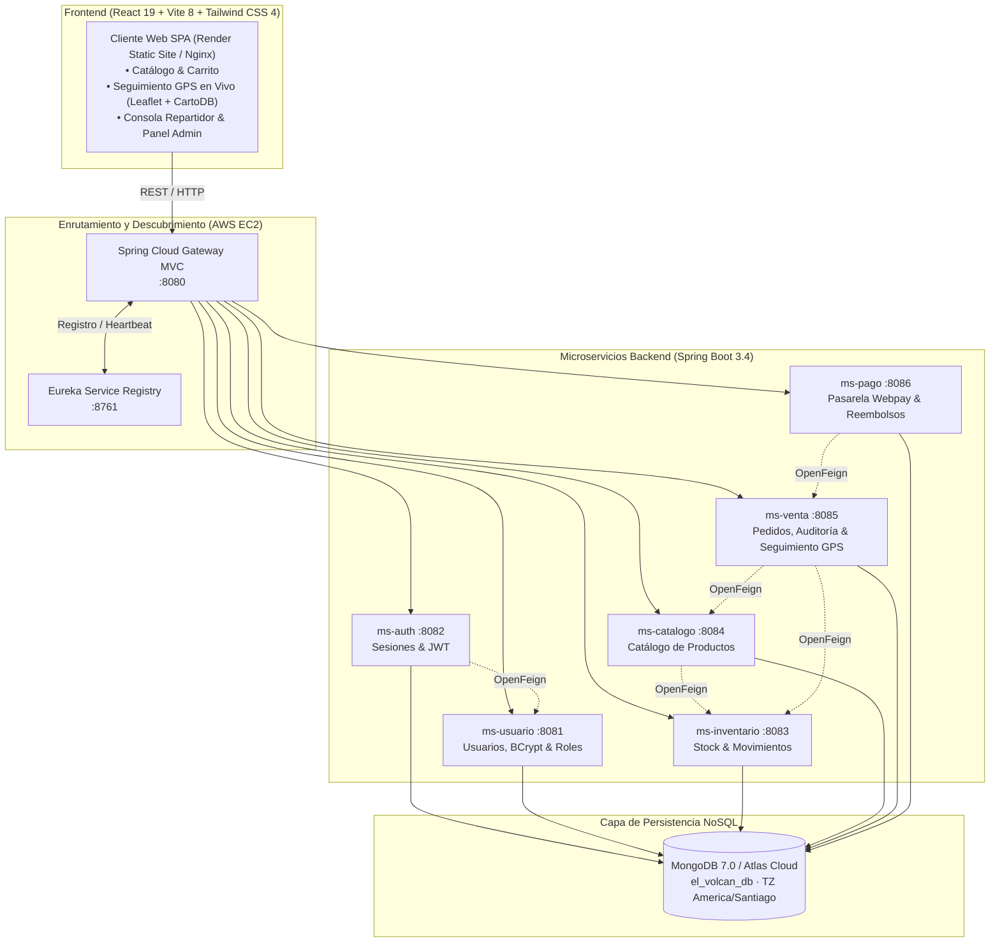

# 🌋 El Volcán — Sistema de Venta y Distribución de Gas Licuado

Plataforma integral de comercio electrónico, gestión de inventario y logística de distribución con seguimiento GPS en vivo para **El Volcán**. Construida bajo una **arquitectura distribuida de microservicios** con **Java 17 / Spring Boot 3.4**, **Spring Cloud 2024**, **MongoDB 7.0 / Atlas Cloud**, **Docker Compose** y un **Frontend SPA en React 19**, con zona horaria oficial unificada en **`America/Santiago`**.

---

## 🏗️ Arquitectura del Sistema



---

## 🛠️ Tecnologías Utilizadas

### 🔹 Backend & Microservicios
- **Java 17 & Spring Boot 3.4.0** con **Spring Boot Actuator** (`/actuator/health`) en los 8 servicios.
- **Spring Cloud 2024.0.0**: **Netflix Eureka Server**, **Spring Cloud Gateway MVC**, **OpenFeign** y **Spring Cloud LoadBalancer**.
- **Seguridad**: **JJWT 0.12.6** (tokens firmados con claims de perfil completos y revocación en logout/cambio de clave) y **BCrypt** (`Spring Security Crypto`).
- **Persistencia**: **Spring Data MongoDB** con conversores explícitos para **`America/Santiago`** e índices geoespaciales `2dsphere`.
- **Herramientas**: **MapStruct 1.5.5**, **Lombok 1.18.34**, **Springdoc OpenAPI 2.8.0 (Swagger UI)** y **Maven Wrapper (`mvnw`)**.

### 🔹 Frontend Moderno (SPA)
- **React 19 (`19.2.8`)**, **Vite 8 (`8.3.0`)**, **React Router DOM 7 (`7.18.4`)** y **Tailwind CSS 4 (`4.1.14`)**.
- **Leaflet (`1.9.4`) + CartoDB + OSRM**: Mapas interactivos y seguimiento sincronizado en vivo con `ms-venta`.
- **Calidad y Testing**: **Vitest 5.0**, **Testing Library** y **ESLint 10** (0 errores).

### 🔹 DevOps, AWS EC2 & Render
- **Docker & Docker Compose** con contenedores Alpine configurados con `tzdata` y `TZ=America/Santiago`.
- **Automatización en AWS EC2**: Scripts `backend/scripts/ec2-userdata-setup.sh` y `backend/scripts/ec2-autodeploy.sh` con servicio `systemd` para arranque automático al iniciar la instancia y tarea `cron` diaria a las **03:00 AM hora de Santiago de Chile** que detecta cambios en GitHub y actualiza contenedores automáticamente.
- **Render Static Site** + **Nginx Multi-Stage Build** para el frontend.

---

## 📂 Estructura del Repositorio

```text
ElVolcanDB/
├── backend/
│   ├── eureka-server/           # Registro de servicios Eureka (:8761)
│   ├── gateway-service/         # Spring Cloud Gateway MVC (:8080)
│   ├── ms-auth/                 # Autenticación, sesiones y JWT (:8082)
│   ├── ms-usuario/              # Usuarios, roles y BCrypt (:8081)
│   ├── ms-catalogo/             # Catálogo de cilindros y accesorios (:8084)
│   ├── ms-inventario/           # Stock y movimientos de bodega (:8083)
│   ├── ms-venta/                # Pedidos, seguimiento GPS en vivo y auditoría (:8085)
│   ├── ms-pago/                 # Pagos Webpay y reembolsos (:8086)
│   ├── mongodb/                 # Datos semilla JSON y script Atlas
│   ├── scripts/                 # Auto-arranque EC2 (systemd) y auto-update 03:00 AM Chile (cron)
│   ├── docker-compose.yml       # Orquestador Docker completo (TZ America/Santiago)
│   └── .env.example             # Plantilla de variables de entorno backend
├── frontend/
│   ├── src/                     # SPA React 19 (components, context, pages, service, __tests__)
│   ├── Dockerfile               # Build multi-stage Nginx
│   ├── nginx.conf               # Reverse proxy y soporte SPA
│   └── .env.example             # Plantilla VITE_API_URL y VITE_CARTO_API_KEY
├── .gitattributes               # Normalización de saltos de línea LF para scripts Linux/EC2
├── .gitignore                   # Protección de credenciales y exclusiones
└── README.md                    # Documentación general del proyecto
```

---

## 🚀 Puesta en Marcha Rápida

### Backend (Local o AWS EC2)
```bash
cd backend
cp .env.example .env
docker compose up --build -d
```

### Auto-arranque y Auto-actualización en AWS EC2 (03:00 AM Chile)
```bash
# En una instancia Ubuntu EC2 (o pegar en User Data al crearla):
sudo bash backend/scripts/ec2-userdata-setup.sh
```

### Frontend (Desarrollo y Pruebas)
```bash
cd frontend
npm install
npm run lint
npm test
npm run dev
```
