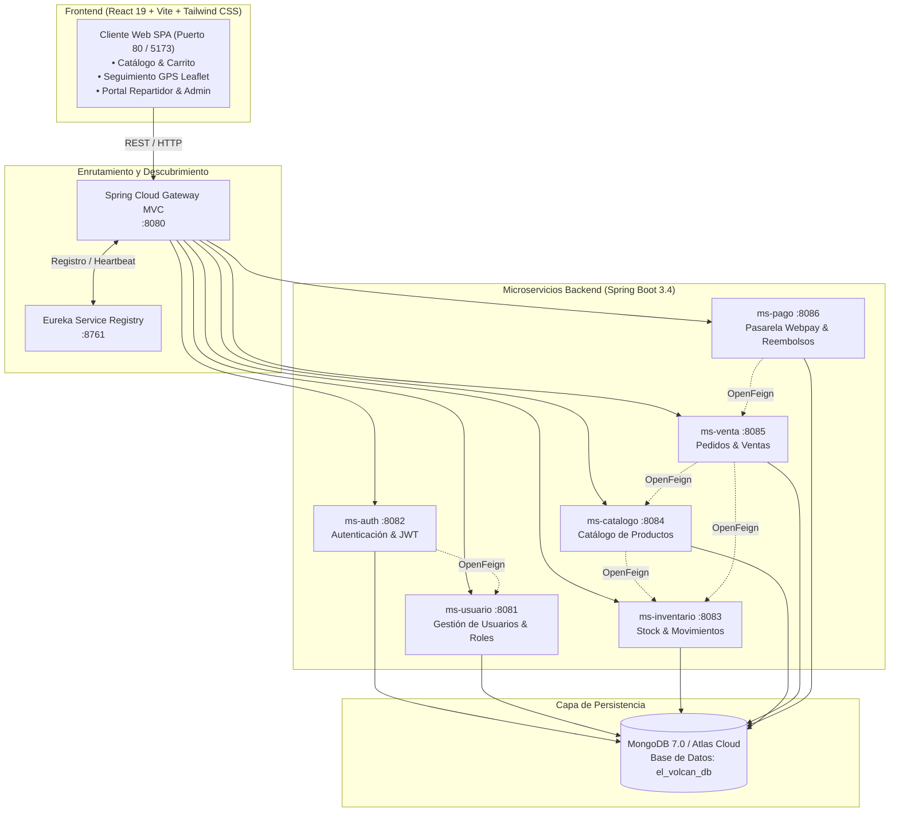

# 🌋 El Volcán — Sistema de Venta y Distribución de Gas Licuado

Plataforma integral de comercio electrónico y logística de distribución de cilindros de gas licuado y accesorios para **El Volcán**. El sistema ha evolucionado de un monolito inicial a una **arquitectura distribuida de microservicios** desacoplada con **Spring Boot 3**, **Spring Cloud**, **MongoDB Atlas**, **Docker Compose** y un **Frontend SPA moderno en React 19**.

---

## 🏗️ Arquitectura del Sistema



---

## 🛠️ Tecnologías Utilizadas

### 🔹 Backend & Microservicios
- **Java 17 & Spring Boot 3.4.0**: Framework base para microservicios de alto rendimiento.
- **Spring Cloud 2024.0.0**:
  - **Netflix Eureka Server (`eureka-server`)**: Registro y descubrimiento dinámico de servicios en puerto `8761`.
  - **Spring Cloud Gateway MVC (`gateway-service`)**: Puerta de enlace única en puerto `8080` que enruta el tráfico `/api/v1/**` y centraliza CORS.
  - **OpenFeign**: Comunicación síncrona declarativa entre microservicios (validación de stock, transacciones de venta y confirmación de pagos).
  - **Spring Cloud LoadBalancer**: Balanceo de carga en llamadas entre servicios.
- **Seguridad & Tokens**:
  - **JSON Web Tokens (JJWT 0.12.6)**: Autenticación 'stateless' basada en tokens y claims.
  - **Spring Security Crypto**: Cifrado seguro de contraseñas (`BCryptPasswordEncoder`).
- **Persistencia**:
  - **Spring Data MongoDB**: Modelado NoSQL, colecciones de usuarios, sesiones, productos, inventario, ventas y pagos.
- **Documentación & Herramientas**:
  - **Springdoc OpenAPI 2.8.0 (Swagger UI)**: Documentación viva de endpoints por microservicio.
  - **MapStruct 1.5.5**: Mapeo DTO ↔ Entidad en tiempo de compilación.
  - **Lombok**: Reducción de código boilerplate.

### 🔹 Base de Datos NoSQL
- **MongoDB 7.0 / MongoDB Atlas Cloud**:
  - Soporte para datos geoespaciales (`GeoJSON` y coordenadas 2dsphere para clientes y repartidores).
  - Esquemas JSON Schema con validaciones estrictas y transacciones ACID multi-documento.
  - Script de inicialización y carga de semillas (`cargar_atlas.js`).

### 🔹 Frontend Moderno (SPA)
- **React 19 (`react` 19.2.8 + `react-dom` 19.2.8)**: Interfaz de usuario declarativa basada en componentes y hooks.
- **Vite 8**: Servidor de desarrollo ultrarrápido y empaquetador de producción.
- **React Router DOM 7**: Enrutamiento declarativo para vistas de cliente, checkout, seguimiento, repartidor y administrador.
- **Tailwind CSS 4**: Diseño responsivo y moderno mediante utilidades utilitarias.
- **Leaflet & OpenStreetMap**: Mapas interactivos para visualización y trazado de rutas de reparto en tiempo real con fallback resiliente.
- **Context API**: Manejo de estado global para carrito de compras (`CarritoContext`) y autenticación de sesión (`SesionContext`).
- **Testing**:
  - **Vitest 5.0**: Motor de pruebas unitarias y de integración de alto rendimiento.
  - **Testing Library (`@testing-library/react` & `@testing-library/jest-dom`)**: Pruebas de integración del DOM y flujos de usuario (25 tests automatizados).

### 🔹 DevOps, Contenedores & Despliegue
- **Docker & Docker Compose**: Orquestación multi-contenedor que levanta MongoDB, Eureka, Gateway y los 6 microservicios con un solo comando.
- **Multi-Stage Builds & Nginx**: Imagen optimizada de frontend servida mediante Nginx con proxy inverso hacia el API Gateway.

---

## 📂 Estructura del Repositorio

```text
ElVolcanDB/
├── backend/
│   ├── eureka-server/           # Registro de servicios Eureka (puerto 8761)
│   ├── gateway-service/         # Spring Cloud Gateway MVC (puerto 8080)
│   ├── ms-auth/                 # Microservicio de autenticación y tokens JWT (8082)
│   ├── ms-usuario/              # Microservicio de usuarios y roles (8081)
│   ├── ms-catalogo/             # Catálogo de cilindros y accesorios (8084)
│   ├── ms-inventario/           # Gestión de stock y movimientos (8083)
│   ├── ms-venta/                # Gestión de pedidos y despachos (8085)
│   ├── ms-pago/                 # Procesamiento y reembolso de pagos Webpay (8086)
│   ├── mongodb/                 # Datos semilla JSON y script de carga Atlas
│   ├── docker-compose.yml       # Orquestador local completo
│   └── .env.example             # Plantilla de variables de entorno backend
├── frontend/
│   ├── src/
│   │   ├── components/          # Componentes modulares (admin, mapa, pedido, etc.)
│   │   ├── context/             # Estados globales (Carrito, Sesión)
│   │   ├── pages/               # Páginas principales (Inicio, Productos, Checkout...)
│   │   ├── service/             # Conexión con endpoints REST del API Gateway
│   │   └── __tests__/           # Suite de pruebas automatizadas con Vitest
│   ├── Dockerfile               # Construcción multi-stage Nginx
│   ├── nginx.conf               # Configuración Nginx y reverse-proxy
│   ├── package.json             # Dependencias React 19, Tailwind 4, Leaflet
│   └── vite.config.js           # Configuración Vite
├── .gitignore                   # Protección de credenciales y exclusiones
└── README.md                    # Documentación general del proyecto
```

---

## 🚀 Puesta en Marcha

### 1. Requisitos Previos
- **Docker Desktop** (para ejecución contenerizada) o **Java 17 JDK** + **Node.js 20+** (para desarrollo local).
- Cluster de **MongoDB Atlas** o MongoDB local en puerto `27017`.

### 2. Ejecutar con Docker Compose (Recomendado)
```bash
# 1. Posicionarse en backend
cd backend

# 2. Configurar variables de entorno (opcional si usas MongoDB Atlas)
cp .env.example .env

# 3. Levantar todos los servicios
docker compose up --build -d
```

### 3. Ejecutar Frontend en Desarrollo
```bash
cd frontend
npm install
npm run dev
```
La aplicación estará disponible en `http://localhost:5173`.

### 4. Ejecutar Pruebas Automatizadas
```bash
cd frontend
npm test
```

---

## 📌 URLs y Dashboards de Consulta
- **Eureka Server Dashboard**: [http://localhost:8761](http://localhost:8761)
- **API Gateway**: [http://localhost:8080](http://localhost:8080)
- **Documentación Swagger / OpenAPI**:
  - `ms-usuario`: `http://localhost:8081/doc/swagger-ui.html`
  - `ms-auth`: `http://localhost:8082/doc/swagger-ui.html`
  - `ms-inventario`: `http://localhost:8083/doc/swagger-ui.html`
  - `ms-catalogo`: `http://localhost:8084/doc/swagger-ui.html`
  - `ms-venta`: `http://localhost:8085/doc/swagger-ui.html`
  - `ms-pago`: `http://localhost:8086/doc/swagger-ui.html`
