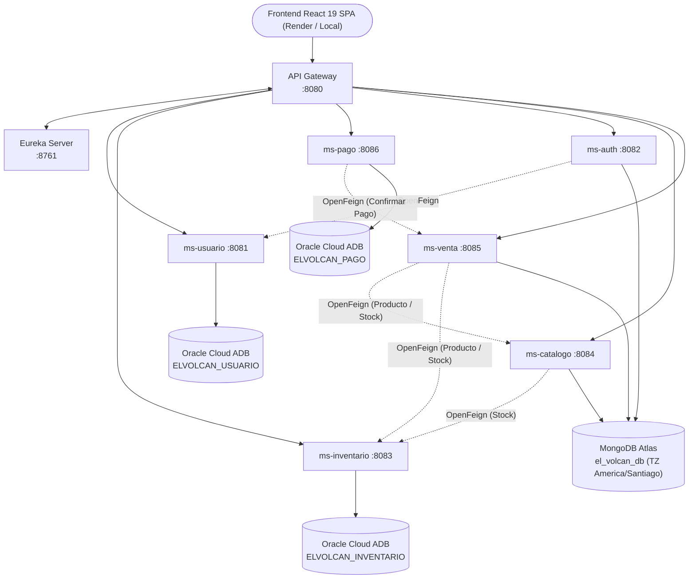

# El Volcán — Backend de Microservicios (Persistencia Políglota: Oracle Cloud SQL + MongoDB Atlas)

Sistema distribuido de venta, gestión de inventario, pagos y logística de distribución de gas licuado y accesorios **El Volcán**, construido con una **arquitectura de microservicios con persistencia políglota** sobre **Java 17**, **Spring Boot 3.4.0**, **Spring Cloud 2024.0.0**, **Oracle Cloud Autonomous Database (26ai, Spring Data JPA + Flyway + mTLS Wallet)**, **MongoDB Atlas (Spring Data MongoDB)**, **OpenFeign**, **JJWT**, **MapStruct**, **Spring Boot Actuator**, **Swagger / OpenAPI 3** y **Docker Compose**, con zona horaria unificada en **`America/Santiago`**.

---

## 1. Arquitectura Políglota y Responsabilidades de los Microservicios

Cada microservicio posee su propio motor de persistencia según la naturaleza de sus datos (patrón *Database-per-Service* + *Polyglot Persistence*):

| Servicio | Puerto | Motor de Datos | Esquema / Colecciones | Responsabilidad Principal |
|---|---|---|---|---|
| `eureka-server` | `8761` | — | — | Servidor de registro y descubrimiento de microservicios (Netflix Eureka). |
| `gateway-service` | `8080` | — | — | Puerta de enlace única (Spring Cloud Gateway MVC) que enruta `/api/v1/**` y gestiona CORS centralizado. |
| `ms-usuario` | `8081` | **Oracle SQL** (`ELVOLCAN_USUARIO`) | `USUARIO` (Flyway `V1`) | Gestión de usuarios (`ADMIN`, `OPERADOR`, `REPARTIDOR`, `CLIENTE`), unicidad estricta de email/RUT y cifrado BCrypt. |
| `ms-inventario` | `8083` | **Oracle SQL** (`ELVOLCAN_INVENTARIO`) | `INVENTARIO`, `MOVIMIENTO_INVENTARIO` (FK + `@Version` + bloqueo pesimista) | Control ACID de stock actual/mínimo y trazabilidad transaccional de movimientos (`ENTRADA`, `SALIDA`, `AJUSTE`, `SOLICITUD_REPOSICION`). |
| `ms-pago` | `8086` | **Oracle SQL** (`ELVOLCAN_PAGO`) | `PAGO` (`NUMBER(12,2)` / `BigDecimal`) | Procesamiento, validación y reembolso ACID de pagos Webpay asociados a las ventas, notificando a `ms-venta` vía OpenFeign. |
| `ms-auth` | `8082` | **MongoDB Atlas** (`el_volcan_db`) | `sesion_auth` (índice TTL en `fecha_expiracion`) | Autenticación centralizada (`login`, `registro`, `recuperar-clave`, `validar`, `logout`), emisión/revocación de tokens JWT con expiración automática. |
| `ms-catalogo` | `8084` | **MongoDB Atlas** (`el_volcan_db`) | `producto_catalogo`, `productos` | Catálogo flexible de productos e imágenes `.webp`, enriquecido con stock en tiempo real desde `ms-inventario` vía OpenFeign. |
| `ms-venta` | `8085` | **MongoDB Atlas** (`el_volcan_db`) | `venta`, `zonas_despacho`, `repartidores` (`2dsphere`) | Pedidos con líneas embebidas, auditoría, alertas en ruta y **seguimiento GPS en vivo** (`PUT /api/v1/ventas/{id}/seguimiento`). |

---

## 2. Diagrama de Arquitectura Políglota



---

## 3. Configuración de Oracle Cloud Autonomous Database (mTLS Wallet)

1. Crea una instancia **Autonomous Database (Transaction Processing, Always Free)** en Oracle Cloud Infrastructure (OCI).
2. Ejecuta [oracle-init-schemas.sql](scripts/oracle-init-schemas.sql) conectado como `ADMIN` en **Database Actions (SQL Developer Web)** reemplazando los placeholders de contraseña para crear los tres esquemas (`ELVOLCAN_USUARIO`, `ELVOLCAN_INVENTARIO`, `ELVOLCAN_PAGO`).
3. Descarga la **Instance Wallet** desde OCI y descomprime su contenido dentro de `backend/wallet/` (protegida por `.gitignore` para no subir nunca certificados ni claves al repositorio).
4. Configura `backend/.env` a partir de `backend/.env.example` indicando `ORACLE_TNS_ALIAS` (ej. `elvolcandb_tp`) y las credenciales de cada esquema junto con `MONGO_URI`.
5. Al iniciar Docker Compose, la Wallet se monta en modo solo lectura (`/app/wallet:ro`), **Flyway** aplica automáticamente las migraciones `V1__init_*.sql` y los inicializadores cargan los datos semilla de manera idempotente.
6. *(Opcional)* Si deseas importar datos existentes de MongoDB Atlas hacia Oracle SQL, ejecuta:
   ```bash
   node backend/scripts/migrar-atlas-a-oracle.mjs
   ```

---

## 4. Zona Horaria y Timestamps (`America/Santiago`)

Todos los contenedores Alpine instalan `tzdata`, establecen `TZ=America/Santiago` y ejecutan la JVM con `-Duser.timezone=America/Santiago`:
* Los microservicios **Oracle SQL** configuran `spring.jpa.properties.hibernate.jdbc.time_zone=America/Santiago` y pools HikariCP acotados (`ORACLE_POOL_MAX=4` por servicio) para respetar los límites de sesiones concurrentes de Oracle Always Free.
* Los microservicios **MongoDB Atlas** registran conversores explícitos (`LocalDateTime <-> Date`) en `America/Santiago`, con índice TTL automático en `sesion_auth.fecha_expiracion` e índices geoespaciales `2dsphere` en `venta` y `repartidores`.

---

## 5. Cómo levantar el proyecto con Docker Compose

```bash
cd backend
cp .env.example .env   # Configura MONGO_URI y credenciales ORACLE_*
# Descomprime la Wallet OCI en backend/wallet/
docker compose up --build -d
```

### URLs disponibles al iniciar:
- **Eureka Dashboard**: `http://localhost:8761`
- **API Gateway Health**: `http://localhost:8080/actuator/health`
- **Swagger `ms-usuario`**: `http://localhost:8081/doc/swagger-ui.html`
- **Swagger `ms-auth`**: `http://localhost:8082/doc/swagger-ui.html`
- **Swagger `ms-inventario`**: `http://localhost:8083/doc/swagger-ui.html`
- **Swagger `ms-catalogo`**: `http://localhost:8084/doc/swagger-ui.html`
- **Swagger `ms-venta`**: `http://localhost:8085/doc/swagger-ui.html`
- **Swagger `ms-pago`**: `http://localhost:8086/doc/swagger-ui.html`

---

## 6. Automatización en AWS EC2 (Auto-arranque + Auto-update 03:00 AM Chile + IP Pública Dinámica)

En `backend/scripts/` se incluyen scripts para operar en AWS EC2 (Ubuntu 22.04/24.04):
* **`backend/scripts/ec2-userdata-setup.sh`**: Configura `America/Santiago`, SWAP de 4 GB, Docker + Compose, servicio `systemd` y cron diario a las **03:00 AM Chile**.
* **`backend/scripts/ec2-autodeploy.sh`**: Detecta nuevos commits en `origin/main`, actualiza el clon (preservando `backend/.env` y `backend/wallet/`) y reconstruye contenedores.
* **`backend/scripts/ec2-sync-ip.sh`**: Detecta la IPv4 pública vía IMDSv2 y actualiza automáticamente `VITE_API_URL` en Render y/o DuckDNS.

---

## 7. Pruebas Unitarias e Integración JPA/Flyway

Cada microservicio incluye Maven Wrapper completo (`mvnw` / `mvnw.cmd`). Los servicios Oracle SQL incluyen pruebas `@DataJpaTest` con H2 en modo `MODE=Oracle` ejecutando las migraciones Flyway reales:

```bash
cd backend/ms-pago && ./mvnw test
cd backend/ms-inventario && ./mvnw test
cd backend/ms-usuario && ./mvnw test
cd backend/ms-auth && ./mvnw test
cd backend/ms-venta && ./mvnw test
```
