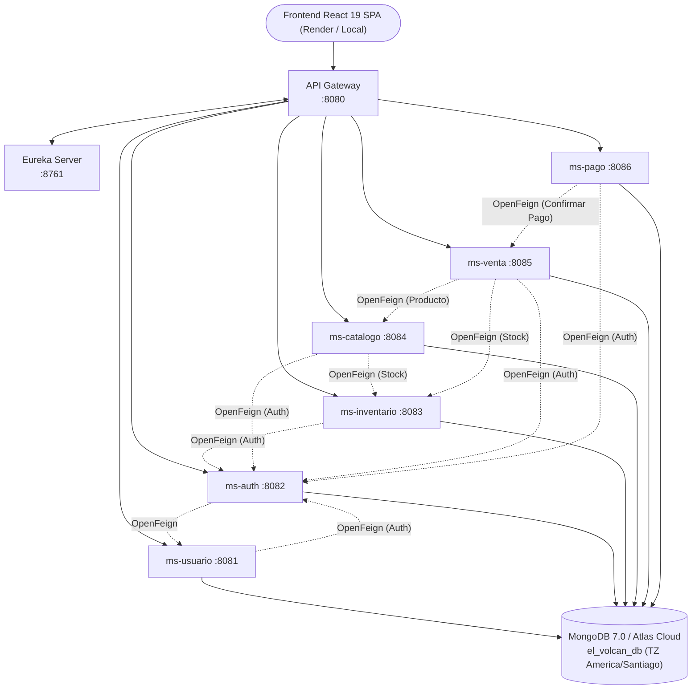

# El Volcán — Backend de Microservicios (Spring Boot + MongoDB Atlas)

Sistema distribuido de venta, gestión de inventario, pagos y logística de distribución de gas licuado y accesorios **El Volcán**, construido con una **arquitectura de microservicios** sobre **Java 17**, **Spring Boot 3.4.0**, **Spring Cloud 2024.0.0**, **Spring Data MongoDB**, **MongoDB 7.0 / Atlas Cloud**, **OpenFeign**, **JJWT**, **MapStruct**, **Spring Boot Actuator**, **Swagger / OpenAPI 3** y **Docker Compose**, con zona horaria unificada en **`America/Santiago`**.

---

## 1. Arquitectura y Responsabilidades de los Microservicios

| Servicio | Puerto | Persistencia MongoDB (`el_volcan_db`) | Responsabilidad Principal |
|---|---|---|---|
| `eureka-server` | `8761` | — | Servidor de registro y descubrimiento de microservicios (Netflix Eureka). |
| `gateway-service` | `8080` | — | Puerta de enlace única (Spring Cloud Gateway MVC) que enruta `/api/v1/**` y gestiona CORS centralizado. |
| `ms-usuario` | `8081` | `usuario`, `repartidores`, `zonas_despacho` | Gestión de usuarios (`ADMIN`, `OPERADOR`, `REPARTIDOR`, `CLIENTE`), cifrado BCrypt y datos geoespaciales `2dsphere`. |
| `ms-auth` | `8082` | `sesion_auth` | Autenticación centralizada (`login`, `registro`, `recuperar-clave`, `validar`, `logout`), emisión/revocación de tokens JWT. |
| `ms-inventario` | `8083` | `inventario`, `movimiento_inventario` | Control de stock actual/mínimo y registro de movimientos (`ENTRADA`, `SALIDA`, `AJUSTE`, `SOLICITUD_REPOSICION`). |
| `ms-catalogo` | `8084` | `producto_catalogo`, `productos` | Catálogo de productos e imágenes `.webp`, enriquecido con stock en tiempo real desde `ms-inventario` vía OpenFeign. |
| `ms-venta` | `8085` | `venta` | Creación de pedidos, descuento/reposición de stock, asignación de repartidores, auditoría y **seguimiento GPS en vivo** (`PUT /api/v1/ventas/{id}/seguimiento`). |
| `ms-pago` | `8086` | `pago` | Procesamiento, validación y reembolso de pagos Webpay asociados a las ventas, notificando a `ms-venta` vía OpenFeign. |

---

## 2. Diagrama de Arquitectura



---

## 3. Zona Horaria y Timestamps (`America/Santiago`)

Todos los contenedores Alpine instalan `tzdata`, establecen `TZ=America/Santiago` y ejecutan la JVM con `-Duser.timezone=America/Santiago`. Además:
* Cada microservicio registra conversores explícitos de Spring Data MongoDB (`LocalDateTime <-> Date`) fijados a `ZoneId.of("America/Santiago")`.
* Cada documento con marcas de tiempo (`venta`, `pago`, `sesion_auth`, `inventario`, `movimiento_inventario`) almacena tanto la fecha BSON como su representación legible ISO-8601 con offset chileno (`fecha_*_chile`, ej. `2026-11-20T00:15:00-03:00`) y `zona_horaria: "America/Santiago"`.

---

## 4. Cómo levantar el proyecto con Docker Compose

```bash
cd backend
cp .env.example .env   # Configura MONGO_URI con tu cluster de MongoDB Atlas
docker compose up --build -d
```

### URLs disponibles al iniciar:
- **Eureka Dashboard**: `http://localhost:8761`
- **API Gateway Health**: `http://localhost:8080/actuator/health`
- **Swagger `ms-usuario`**: `http://localhost:8081/doc/swagger-ui.html`
- **Swagger `ms-auth`**: `http://localhost:8082/doc/swagger-ui.html`
- **Swagger `ms-inventario`**: `http://localhost:8083/doc/swagger-ui.html`
- **Swagger `ms-catalogo`**: `http://localhost:8084/doc/swagger-ui.html`
- **Swagger `ms-venta`**: `http://localhost:8085/doc/swagger-ui.html`
- **Swagger `ms-pago`**: `http://localhost:8086/doc/swagger-ui.html`

---

## 5. Automatización en AWS EC2 (Auto-arranque + Auto-update 03:00 AM Chile + IP Pública Dinámica)

En `backend/scripts/` se incluyen tres scripts para operar sin intervención manual en AWS EC2 (Ubuntu 22.04/24.04):

* **`backend/scripts/ec2-userdata-setup.sh`**:
  * Se puede pegar en **User Data** al crear la instancia EC2 o ejecutar una sola vez con `sudo bash backend/scripts/ec2-userdata-setup.sh`.
  * Configura `America/Santiago`, crea SWAP de 4 GB, instala Docker + Compose, habilita el servicio `systemd` (`elvolcan-docker.service`) para iniciar automáticamente los contenedores en cada arranque de EC2 y programa la actualización diaria vía Cron a las **03:00 AM hora de Santiago de Chile**.
* **`backend/scripts/ec2-autodeploy.sh`**:
  * Detecta automáticamente si existen nuevos commits en `origin/main` de GitHub. Si hay cambios, actualiza el clon (preservando `backend/.env`), reconstruye y levanta los contenedores con `docker compose up --build -d --remove-orphans`, limpia imágenes huérfanas, dispara la sincronización de IP pública y registra todo en `/var/log/elvolcan-autodeploy.log`.
* **`backend/scripts/ec2-sync-ip.sh`**:
  * Al iniciar la instancia EC2 (ideal para AWS Academy donde cambia la IP pública al reiniciar el laboratorio), detecta la nueva IPv4 pública vía **EC2 IMDSv2** (`169.254.169.254`) y actualiza automáticamente `VITE_API_URL` en Render + dispara el deploy del frontend (usando `RENDER_API_KEY` y `RENDER_SERVICE_ID` en `backend/.env`, sin tocar `VITE_CARTO_API_KEY`), y/o actualiza DuckDNS (`DUCKDNS_DOMAIN` + `DUCKDNS_TOKEN`).

---

## 6. Pruebas Unitarias por Microservicio

Cada microservicio incluye Maven Wrapper completo (`mvnw` / `mvnw.cmd`):

```bash
cd backend/ms-auth && ./mvnw test
cd backend/ms-venta && ./mvnw test
```
